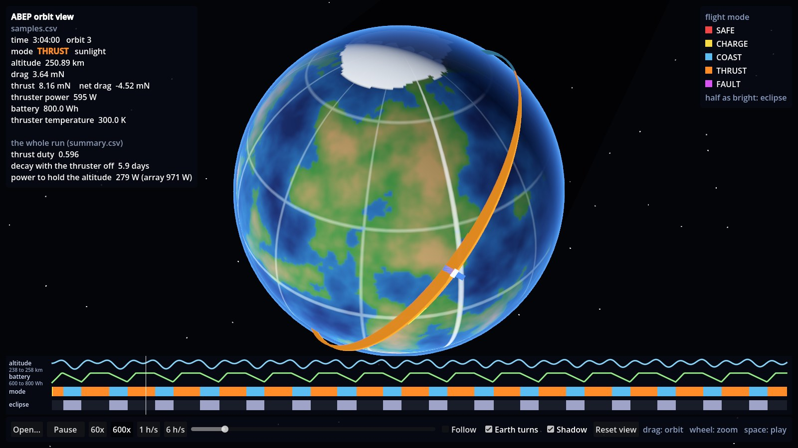

# ABEP: Ion Thrusters Simulator

**An open, deterministic simulator for one question: how much power must an air-breathing electric thruster have to hold a satellite's altitude in low Earth orbit?**

**Status: early.** The orbit propagator (two-body gravity plus J2), drag, and the density of the 1976 US Standard Atmosphere from 100 to 1000 km are written and tested against known answers. The atmosphere is the printed table, read from the report and checked several ways ([`docs/ATMOSPHERE.md`](docs/ATMOSPHERE.md)). The ABEP thrust model (limited by power or by the intake), the eclipse and solar-power model and an ideal battery are written too, and the drag and intake mass flow agree with a published paper's curves to within 1% ([`docs/ABEP_MODEL.md`](docs/ABEP_MODEL.md)). The flight state machine (SAFE, CHARGE, COAST, THRUST, FAULT) is written and tested too, with a thruster temperature and a mission run that drives it through the orbit, power and thermal models ([`docs/FLIGHT_MODES.md`](docs/FLIGHT_MODES.md)); its thresholds are operating policy and its thermal numbers are assumptions. The CSV output, the two summary outputs (the time to decay with the thruster off, and the power to hold the altitude) and a command-line program, `abep_run`, that writes them are written and tested too ([`docs/OUTPUT.md`](docs/OUTPUT.md)), and so is a Python module (pybind11) that runs the same simulation and returns the results as plain dicts and lists, tested on Linux only. A small Godot program, [`viewer/`](viewer/), plays the CSV files back as an orbit with the flight mode, the eclipses and the numbers of the moment; it is optional, and tested by hand, not in the CI. The model has been compared with published results: it agrees with the curves of Romano et al. (2018), with ESA's figures for GOCE and with two design points quoted in Romano et al.'s review, and it does not reproduce the powers quoted for one concept study (JAXA's), which is recorded as an open finding. A second program, `abep_sweep`, runs the mission over a grid of settings and writes one row of results for each ([`docs/SWEEPS.md`](docs/SWEEPS.md)), and the limits of the model are written out in [`docs/LIMITATIONS.md`](docs/LIMITATIONS.md). Four more atmospheres, for low, moderate and high solar activity (from ECSS-E-ST-10-04C), can be chosen with a setting, and the atmosphere can be swept, so that a result can be given as a bracket ([`docs/ATMOSPHERE.md`](docs/ATMOSPHERE.md)). See [`docs/SPEC.md`](docs/SPEC.md) for what v0.1 will do and [`docs/VALIDATION.md`](docs/VALIDATION.md) for what has and has not been checked, including the failed first attempts.

## What it will do

Given a satellite's mass, frontal area and drag coefficient, an orbit, a solar-power budget and an assumed thrust density, the simulator will propagate the orbit (two-body gravity plus J2) through a standard atmosphere, apply drag and thrust, and report net drag, altitude over time and thruster duty cycle, including eclipses. Results come out as CSV (`abep_run`, below) or, from Python, as dicts and lists ([`docs/OUTPUT.md`](docs/OUTPUT.md)). An optional orbit view ([`viewer/`](viewer/), in Godot) plays the files back as a picture.

## Limits

- **It does not predict thruster performance.** Thrust here is a parameter: power times an assumed thrust density, limited by an assumed intake capture. Real intake efficiency is unproven, and, to our knowledge, ground tests have not yet shown net positive thrust. Read the outputs as sensitivities ("if the thrust density were X, the duty cycle would be Y"), never as evidence that a thruster will work.
- **Fixed atmospheres.** By default the density is the 1976 US Standard Atmosphere, a single profile for moderate solar activity. Four profiles for low, moderate and high solar activity can be chosen with `atmosphere=1` to `4`; they differ by a factor of 5 at 250 km and 8 at 300 km between the low and the high. Real density also varies with latitude, local time and season, which none of them models, so absolute decay times are only indicative.
- **Simplified dynamics.** Gravity is a point mass plus J2 (no higher harmonics), with a fixed frontal area, no attitude dynamics, no third bodies, no solar radiation pressure.
- **Early.** Until [`docs/VALIDATION.md`](docs/VALIDATION.md) says a case is done, treat that part of the model as unchecked.

The long version of these limits, with what has been checked against each, is in [`docs/LIMITATIONS.md`](docs/LIMITATIONS.md).

## Build and test

C++17 and CMake 3.16 or newer. No other dependency.

```bash
cmake -S . -B build -DCMAKE_BUILD_TYPE=Release
cmake --build build
ctest --test-dir build --output-on-failure
```

Run a mission and write its results as CSV (the defaults are illustrative, not data about any real satellite; `--help` lists every setting):

```bash
./build/abep_run altitude_km=300 mass_kg=150 duration_days=3 out=my_run
```

That writes `samples.csv`, `orbits.csv` and `summary.csv` into `my_run/`; the columns, and how the time to decay and the power to hold the altitude are defined, are in [`docs/OUTPUT.md`](docs/OUTPUT.md).

To watch a run, play the folder back in the orbit view (Godot 4.6; [`viewer/README.md`](viewer/README.md) says how it works and what it assumes):

```bash
godot --path viewer -- my_run
```



To see how the power to hold the altitude depends on the orbit and the thruster, sweep settings and write one row of results per point ([`docs/SWEEPS.md`](docs/SWEEPS.md) has the columns and two worked tables):

```bash
./build/abep_sweep altitude_km=160:300:8 thrust_density_mn_per_kw=10,12,14 out=hold_power.csv
```

The atmosphere is a setting too, so a sweep can give a bracket and not one number: `atmosphere=0:4:5` runs the 1976 standard and the four solar-activity profiles ([`docs/ATMOSPHERE.md`](docs/ATMOSPHERE.md)):

```bash
./build/abep_sweep altitude_km=160,200,250,300 atmosphere=0:4:5 out=bracket.csv
```

## Roadmap to v0.1

1. Scope, repository and specification *(done)*
2. Core physics: a two-body plus J2 orbit propagator, a standard-atmosphere density model and drag, tested against known answers *(done: propagator, J2, drag and the 1976 standard-atmosphere table)*
3. ABEP model: thrust from power and thrust density, limited by intake capture, with solar power and eclipse *(done, and checked against a published drag curve; the exhaust velocity and the ram-drag question are open, see [`docs/ABEP_MODEL.md`](docs/ABEP_MODEL.md))*
4. A deterministic flight state machine: SAFE, CHARGE, COAST, THRUST, FAULT *(done, with a mission run that couples it to the orbit, power and thermal models, see [`docs/FLIGHT_MODES.md`](docs/FLIGHT_MODES.md))*
5. CSV output and Python bindings; an optional orbit view that must not delay the core *(the CSV output, the two summary outputs, `abep_run` and the Python module are done, see [`docs/OUTPUT.md`](docs/OUTPUT.md); the module is tested on Linux only, the orbit view is in [`viewer/`](viewer/), tested by hand and not in the CI)*
6. Validation against at least three published results, a limitations write-up, parameter sweeps *(done: the model agrees with the curves of Romano et al., with ESA's GOCE figures and with design points quoted in Romano et al.'s review, and does not reproduce one quoted study, see [`docs/VALIDATION.md`](docs/VALIDATION.md), cases 25 to 28 and finding 23; [`docs/LIMITATIONS.md`](docs/LIMITATIONS.md); `abep_sweep`, [`docs/SWEEPS.md`](docs/SWEEPS.md))*
7. The v0.1 release, with a short technical note and a walkthrough video *(the technical note is written, [`docs/TECHNICAL_NOTE.md`](docs/TECHNICAL_NOTE.md) and its [PDF](docs/TECHNICAL_NOTE.pdf); the video and the release are to do, see [`CHANGELOG.md`](CHANGELOG.md))*
8. A retrospective, and a choice of the next module

After v0.1, module two: the atmosphere at low, moderate and high solar activity *(done: `atmosphere=1` to `4`, [`docs/ATMOSPHERE.md`](docs/ATMOSPHERE.md))*, then the orbital lifetime of debris-like objects.

## Part of Overby Industries

This repository is one of the software-first projects described in the [Overby Industries profile](https://github.com/Overby-Industries). The propulsion concept it examines is described in [`power-and-propulsion`](https://github.com/Overby-Industries/power-and-propulsion) and in the papers in [`whitepapers`](https://github.com/Overby-Industries/whitepapers).

## Contributing

See [`CONTRIBUTING.md`](CONTRIBUTING.md) and [`CODE_OF_CONDUCT.md`](CODE_OF_CONDUCT.md). The most useful contributions right now are sources: a published thrust-density figure, a published drag-versus-altitude curve, a second reading of the atmosphere tables against their reports (the 1976 standard's and the ECSS standard's), a citable source for how density varies with latitude and local time, or a critique of the model assumptions in the spec.

## License

[Apache 2.0](LICENSE).
