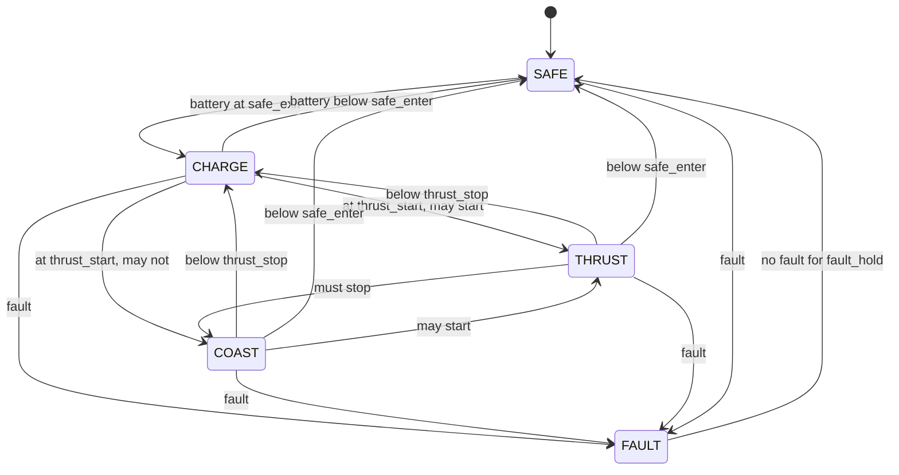

# The flight state machine

What decides when the thruster runs: five modes, the flags that move the satellite between them, and the run that drives them against the orbit, power and thermal models. Code: [`flight.hpp`](../include/abep/flight.hpp) (the machine), [`thermal.hpp`](../include/abep/thermal.hpp) (a thruster temperature, so there is a thermal flag to react to) and [`mission.hpp`](../include/abep/mission.hpp) (the run). **Every threshold here is operating policy chosen by whoever runs the simulator, and the thermal numbers are assumptions with no source behind them.** Nothing says that any real satellite or thruster behaves this way; it is a way to see how the answer moves when the policy or the assumptions change.

## The modes

| Mode | Thruster | Bus load | Meaning |
|---|---|---|---|
| SAFE | off | shed (`safe_load`) | Survival. Entered on a deep discharge, and after a fault. |
| CHARGE | off | normal | The battery fell below the level where thrusting continues, and recharges to the level where it may restart. |
| COAST | off | normal | The battery is fine but something holds the thruster back: no sunlight, too little air, a thruster too hot, no thruster, or a battery not yet back at the restart level. |
| THRUST | on | normal | The thruster runs at its rated power, or at what the intake and the battery can feed it. |
| FAULT | off | shed | A fault is active, or was within the hold time. |

A satellite starts in SAFE. The machine makes at most one transition per control step, so a healthy start reads CHARGE at the first step and THRUST at the second (SAFE is the state before the first step, and is not seen in the output).

## What the machine looks at

| Flag | From | Used for |
|---|---|---|
| `battery_fraction` | battery energy over capacity | every power threshold |
| `sunlit` | the array is producing: false in shadow and during an array outage | `thrust_in_eclipse` |
| `density_kg_m3` | the atmosphere table at the satellite's altitude | the least air the thruster is run in |
| `temperature_k` | the thruster's thermal node | the thermal limit, restart and fault levels |
| `thruster_available` | the scenario (false for a drag-only run, or a thruster that has failed) | THRUST is never entered |
| `fault` | an external condition: a scheduled fault window, or a brownout (the battery could not meet the load in the last step) | FAULT |

## The rules

Applied once per step, in this order; the first that applies decides the mode for the step.

1. **Fault.** The `fault` flag, or a temperature at or above `temperature_fault_k`, puts any mode in FAULT, and the count of fault-free time starts again.
2. **FAULT.** After `fault_hold_s` with no fault condition, FAULT hands over to SAFE. It never goes anywhere else.
3. **SAFE.** Goes to CHARGE once the battery is at `soc_safe_exit` (0.30) or more.
4. **Deep discharge.** In CHARGE, COAST or THRUST, a battery below `soc_safe_enter` (0.10) goes to SAFE.
5. **CHARGE.** Goes on at `soc_thrust_start` (0.50): to THRUST if the thruster may start, to COAST if not.
6. **COAST.** Below `soc_thrust_stop` (0.20) goes to CHARGE. Otherwise goes to THRUST as soon as the thruster may start.
7. **THRUST.** Below `soc_thrust_stop` goes to CHARGE. Otherwise goes to COAST as soon as the thruster must stop.

*May start*: a thruster is available; the array is producing (or `thrust_in_eclipse`); the battery is at `soc_thrust_start` or more; the density is at `min_density_start` or more; the temperature is at `temperature_resume_k` or less. *Must stop* (any one of): no thruster; no array power and not `thrust_in_eclipse`; density below `min_density_stop`; temperature at `temperature_limit_k` or more. The stop and start levels differ on purpose: a flag that wanders around one threshold does not make the mode flip every step, and a satellite that has stopped for any reason recharges to the restart level before it thrusts again. (The first version let COAST restart at the stop level, which bypassed this; see [VALIDATION.md](VALIDATION.md), finding 13.)

## The thresholds

| Setting | Default | What it means |
|---|---|---|
| `soc_safe_enter`, `soc_safe_exit` | 0.10, 0.30 | Deep discharge, and where SAFE ends. |
| `soc_thrust_stop`, `soc_thrust_start` | 0.20, 0.50 | Where thrusting stops for lack of charge, and where it may restart. |
| `thrust_in_eclipse` | false | Thrust only while the array is producing. |
| `min_density_start`, `min_density_stop` | 0, 0 | The least air to run in (kg/m^3). Zero: never a reason to stop. |
| `temperature_resume_k`, `_limit_k`, `_fault_k` | infinity | Restart, stop and fault temperatures. Infinity: the thermal flag never trips. |
| `fault_hold_s` | 600 | Seconds without a fault before FAULT hands over to SAFE. |

None is sourced; they are chosen so that every mode is visited in the tests. One rule of thumb is worth knowing, because the machine cannot see an eclipse coming: **the battery has to carry the bus load through the longest eclipse from the stop level without reaching the SAFE level**, that is `soc_thrust_stop - soc_safe_enter >= bus_load x eclipse_time / capacity`. A battery of 1200 Wh with a 500 W load and a 36-minute eclipse (300 Wh, 0.25 of the capacity) needs a stop level of at least 0.35 by this rule if thrusting can go on down to it; the tests avoid the question by restarting at 0.50 and thrusting at net zero power, so that each eclipse starts at 0.50 or more.

## The thruster's temperature

A single node: `C dT/dt = Q - G (T - T_sink)`, heated by `Q = P (1 - eta)` where `P` is the electrical power drawn and `eta = 1/2 tau c_e` is the thruster efficiency the thrust model already implies ([ABEP_MODEL.md](ABEP_MODEL.md)): what does not leave as jet power is taken to heat the thruster. `thermal_step` is the exact solution for a constant `Q` over a step, so any split of a time span into steps gives the same temperature. `C`, `G` and `T_sink` are inputs with no source; the tests use 5000 J/K, 5 W/K and 300 K, which give a time constant of 1000 s.

## The mission run

`run_mission` (in `mission.hpp`) drives the machine one fixed step at a time. Each step:

1. **Look.** Altitude above the ellipsoid, density there, speed relative to the (co-rotating) air, sunlight or shadow. A satellite that leaves the density table ends the run with `EndReason::AltitudeOutOfRange`; it is never given an invented density. A scenario can also name an altitude to stop at (`stop_below_altitude_m`), which ends the run with `EndReason::BelowStopAltitude`: it is how [OUTPUT.md](OUTPUT.md) measures a decay time.
2. **Decide.** The flags are built from that and the machine chooses the mode for the step. The mode is chosen from what the satellite sees at the start of the step, so a change takes effect one step late at most.
3. **Power.** The array gives `array_power` in sunlight and when it has not failed, the mode sets the bus load, and in THRUST the thruster is offered its rated power or, if less, what the supply plus the battery can give over the step, so that the thruster alone never empties the battery. The thrust model turns that into thrust and an actual power draw (less than offered if the intake is the limit).
4. **Move.** One RK4 step of gravity (with or without J2), drag and thrust. The thrust is held constant over the step and points along the inertial velocity.
5. **Account.** The battery takes the net power (it saturates when full and when empty; what it could not take or give is recorded as `spilled`), a shortfall is flagged as a fault for the next step, the thruster's temperature is updated, and the time in each mode and the energy books of the orbit are added to.

What it records: a `Sample` per step (time, mode, altitude, density, speed relative to the air, drag, thrust, net drag, powers, battery energy, temperature, sunlight), an `OrbitBalance` per orbit (an orbit being one two-body period of the initial orbit: the time in THRUST and in eclipse, and the energy generated, used by the load, used by the thruster, taken in by the battery and spilled), and the seconds in each mode. Net drag is drag minus thrust as magnitudes; drag acts along the velocity relative to the air and thrust along the inertial velocity, so the two are not exactly opposite. Writing these as CSV is the next piece of work.

## What it leaves out

- **The machine does not know that an eclipse is coming.** It cannot hold energy back for one beyond what its thresholds do (see the rule of thumb above).
- **Thrust is a gross thrust along the velocity**, with the ram-drag question of [ABEP_MODEL.md](ABEP_MODEL.md) open, and there is no attitude: the array always faces the Sun and the intake always faces the flow.
- **The battery is ideal** (no losses, rate limit or ageing), the Sun does not move, and the shadow is a cylinder.
- **The thermal node is one lump** with constant coefficients. Nothing in the model says how hot a real thruster gets or what it tolerates.
- **Faults are scheduled or follow from a brownout.** There is no random failure: the simulator stays deterministic.
- **One step of delay.** A mode change takes effect at the next step, so the step should be small against the times that matter (10 s in the tests, against a shadow crossing of about 35 minutes and a thermal time constant of 1000 s).
