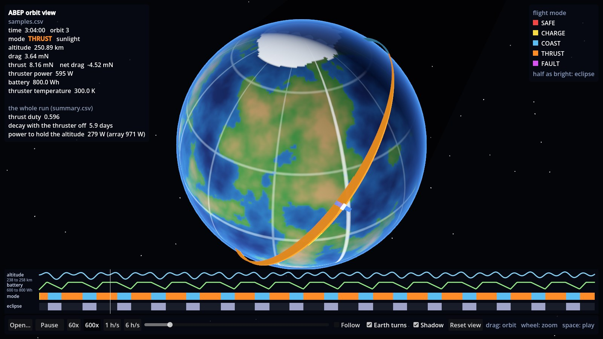
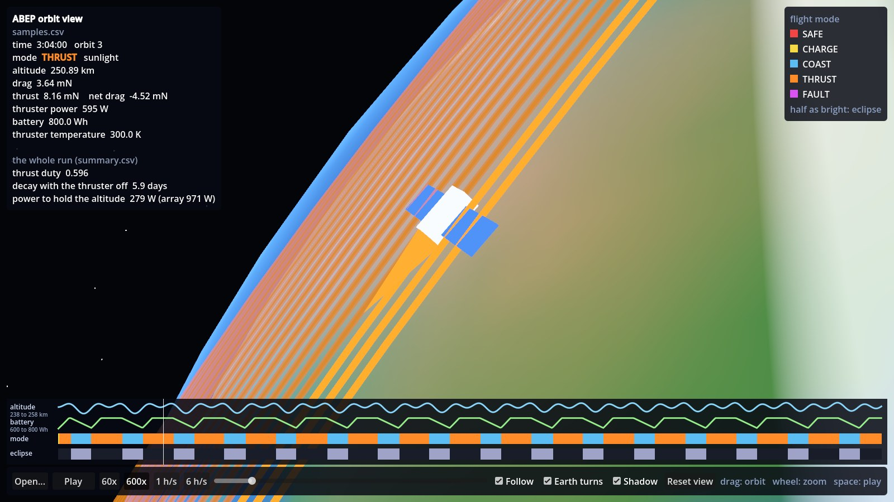

# ABEP orbit view

A small [Godot](https://godotengine.org) program that plays back the CSV files `abep_run` writes: the orbit in 3D, coloured by flight mode and dimmed in eclipse, the satellite with a plume while it thrusts, the Earth turning underneath, the Earth's shadow, and the numbers of the moment (altitude, drag, thrust, battery, thruster temperature). It is optional. Nothing in the simulator needs it, and it only reads files.



## Run it

Godot 4.6 (written and tested with 4.6.3 on Windows; other 4.x versions are untried). It is GDScript only: no add-ons, no C++ build, no export templates, and nothing to import first.

```bash
godot --path viewer                          # the bundled sample, viewer/sample/
godot --path viewer -- my_run                # a folder with a samples.csv in it, as abep_run writes
godot --path viewer -- my_run/samples.csv    # or the file itself
```

Or press **Open...** in the window. It reads `summary.csv` and `orbits.csv` from the same folder when they are there (for the numbers of the whole run and the orbit number), and plays the file from its start.

The rendering is Godot's Forward+ renderer, which needs Vulkan. The Compatibility renderer has not been tried. A run of 30 days (43,200 samples, 10 MB) loaded in about two seconds and played at 60 frames a second on an Intel Iris Xe integrated GPU.

The bundled sample is one day of `abep_run` at its defaults, a sample every two minutes. It is simulation output kept on purpose, and the files are about 167 KB. To make it again:

```bash
abep_run duration_days=1 sample_every=12 out=viewer/sample
```

## What you see

- **The Earth**, a sphere of the equatorial radius with a stylised surface made in code. **It is not real geography**: the model has no epoch and no map, so the continents mean nothing. There is polar ice and a line every 30 degrees; the broad white line is longitude 0. The Earth turns at 7.292115e-5 rad/s from the start of the run, the rate the model's atmosphere turns at, so that the turning can be seen. **Earth turns** holds it still.
- **The Sun**, a long way off along +x, as in the model, with the light coming from there. The dark translucent cylinder behind the Earth is the model's own shadow: a cylinder, with no penumbra. **Shadow** hides it.
- **The orbit**, drawn as thin crossed ribbons along the samples, in the colour of the flight mode in force: SAFE red, CHARGE yellow, COAST blue, THRUST orange, FAULT magenta, each about half as bright in the Earth's shadow. The part already flown is bright, the part still to come is dimmer. A run of many orbits shows as a fan: the plane turns (J2), so the orbits do not lie on one line. In the bundled sample the orbit's axis turns 4.2 degrees in a day.
- **The satellite**, a marker with two panels, pointing along its velocity, with an orange plume while it thrusts (the mode is THRUST and the thrust is not zero). It is drawn far larger than the real satellite, and the ribbons are 60 km wide seen from far; both shrink as the camera comes in.
- **The panel at the top left** gives the time, the orbit number, the mode, sunlight or shadow, and the altitude, drag, thrust, net drag, thruster power, battery and thruster temperature at that moment; under it, the numbers of the whole run from `summary.csv` (thrust duty, the time to decay with the thruster off, the power to hold the altitude).
- **The strip along the bottom** shows the whole run: altitude, battery, the mode as a coloured bar and the eclipses, with a cursor at the time. Click or drag on it to go to a time.



## Controls

| | |
|---|---|
| Left-drag (or right-drag) | turn the camera round what it looks at |
| Mouse wheel | zoom |
| Space, or **Play** / **Pause** | start and stop |
| **60x**, **600x**, **1 h/s**, **6 h/s** | simulated time per second of real time |
| The slider, or a click on the strip | go to a time |
| **Follow** | look at the satellite, from close; drag to go round it |
| **Reset view** | the home view, which is worked out from the orbit: 63 degrees off its axis, so that it is a tilted ring, and turned so that the lit side, the terminator and the shadow are in view |
| **Open...** | choose another `samples.csv` |

## What it assumes

- **It draws what the CSV says and computes nothing.** There is no physics in it: no propagation, no drag, no thrust. Thrust, drag and power are the values of the sample in force; the altitude, battery and temperature are interpolated in a straight line between samples; the position is on the arc between two samples (a circle round the Earth's centre, the radius changing in a straight line). For a near-circular orbit that is within a few kilometres. With samples far apart, or an eccentric orbit, it would not be, so write them often enough (`sample_every`).
- **The frame** is the inertial frame of the initial state, Earth-centred, z along the Earth's axis, the Sun along +x, which is how `abep_run` writes the positions (`x_km`, `y_km`, `z_km`; [`docs/OUTPUT.md`](../docs/OUTPUT.md)). The view's y axis is the Earth's axis. The Earth's angle at the start is arbitrary, since there is no epoch: longitude 0 starts facing the Sun.
- **The globe is a sphere** of the equatorial radius, 6378.137 km. The model's Earth is an ellipsoid up to 21 km flatter at the poles, and the altitude in the file is above that ellipsoid, so near the poles the satellite is drawn up to 21 km higher above the ground than its altitude says.
- **A file from an older `abep_run`** that does not have the position columns is refused, with the name of the column it lacks.

## Tests

Run by hand, with Godot on the path. They are not part of `ctest` or the CI, which have no Godot. `--quit-after` is a safety stop: a script error before the test ends would otherwise leave Godot waiting.

```bash
godot --headless --path viewer --quit-after 900 -s res://tests/trajectory_test.gd   # reading the files, and what the view asks of them
godot --headless --path viewer --quit-after 900 -s res://tests/view_test.gd         # the scene: the satellite, the plume, the camera, the Earth's turn, bad files
```

Both print how many checks ran and how many failed, and exit with 1 if any failed. What they cannot say is that it looks right. That was checked by eye, on pictures from the real renderer, which `tests/shot.gd` takes (it needs a window, off screen is enough; `godot --path viewer --resolution 1600x900 -s res://tests/shot.gd -- orbit_view.jpg thrust` writes `viewer/shots/orbit_view.jpg`, and it can pick a moment in `thrust`, `coast` or `eclipse` and `follow` the satellite). [`docs/VALIDATION.md`](../docs/VALIDATION.md), cases 23 and 24 and finding 20, says what was checked and what was found by looking.

## The Windows download

`deploy_to_itch.ps1`, at the root of the repository, makes the download for the [itch.io page](https://overby-industries.itch.io/ion-propulsion-simulator) and uploads it. What is in it: the viewer exported as one exe, with the bundled sample inside; `abep_run.exe`, built with MSVC with the C++ runtime linked in, so that nothing else has to be installed; a launcher, `Simulate and view.bat`, that runs `abep_run.exe` with the settings in `settings.txt` and opens the result in the viewer; `settings.txt`, which lists every setting of `abep_run` with its default and unit, each commented out, so that a user takes the `#` off a line and changes the number; a README; the Apache 2.0 licence; and the notice of the Godot Engine and of the components inside it, which `tools/dump_godot_licenses.gd` writes (an exported game carries the engine, and the engine's licence asks for its notice to travel with it). The text files that go in are in `package/`, and the export settings are in `export_presets.cfg`.

```powershell
powershell -File deploy_to_itch.ps1 -NoPush   # build and test everything, upload nothing
powershell -File deploy_to_itch.ps1           # and push it to itch.io
```

It needs Godot 4.6.3 with its Windows export templates, Visual Studio's C++ tools and, to push, butler logged in to an account that may push to the page. Before it pushes it runs six tests on what it made: `abep_run.exe` writes its three files (17 columns, 72 samples for 0.05 days); the exported viewer starts, finds the sample inside itself and quits cleanly; the exported viewer plays a run that `abep_run.exe` wrote; the launcher runs the settings as shipped; the launcher reads a user's settings (a note after a number, a leading space, a comment, a blank line); and the launcher names a setting that does not exist. The page shows the version of `include/abep/version.hpp`, a dash and the commit's short hash (`-dirty` if there are uncommitted changes). The download is about 100 MiB, nearly all of it the Godot engine, and butler uploads only what changed after the first push. The programs are not signed, so Windows may warn about them; the download's README says so. The download is left in `viewer/builds/windows-release` (git-ignored).

## Files

| | |
|---|---|
| `project.godot`, `scenes/orbit_view.tscn` | the project, and one scene with one script |
| `scripts/orbit_view.gd` | the scene: the world, the interface, the camera |
| `scripts/trajectory.gd` | one `samples.csv` (and its neighbours) as arrays, and the questions asked of it: no scene, so it is tested alone |
| `scripts/plot_strip.gd`, `scripts/planet_texture.gd` | the strip along the bottom, and the Earth's surface |
| `sample/` | the bundled run. The `.import` files tell Godot not to treat the CSV files as translations |
| `tests/` | the two test scripts, and `shot.gd` |
| `export_presets.cfg`, `package/`, `tools/` | for the Windows download: the export settings, the launcher and README that go in it, and the script that writes Godot's notice |
